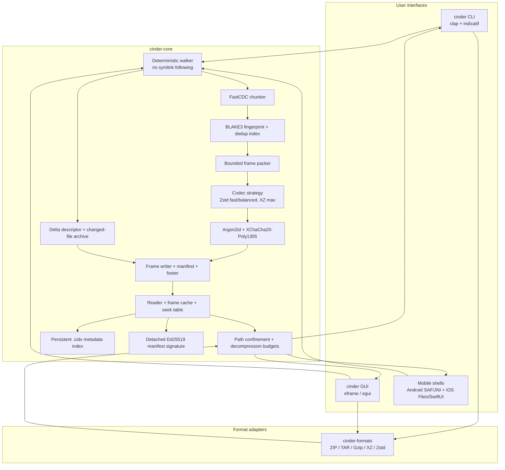
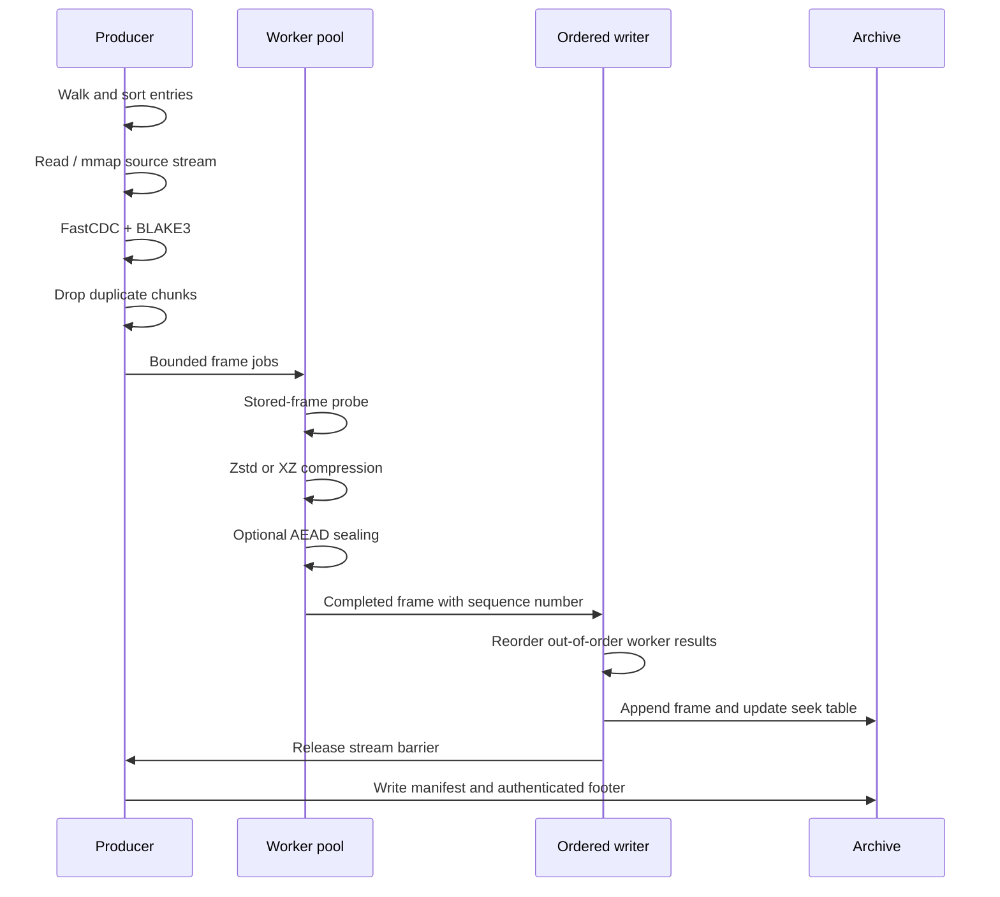
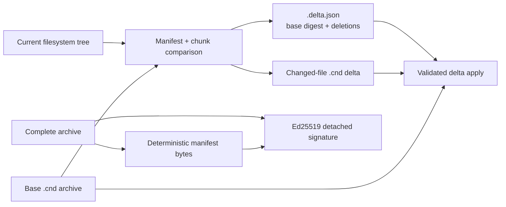
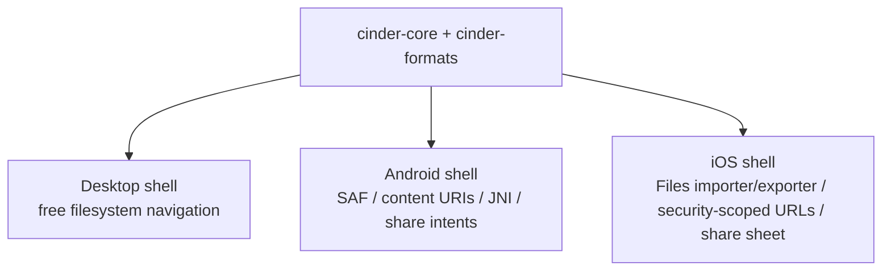

# Cinder architecture

Cinder is split into a format-independent archive engine, foreign-format
adapters, and thin interfaces. The boundaries are intentional: the CLI and
GUI should never duplicate archive safety rules, and mobile shells should be
able to reuse the same lossless core without inheriting desktop filesystem
assumptions.

## System map



## Compression pipeline



The producer and writer use bounded channels. A slow disk therefore applies
backpressure instead of allowing worker output to grow without limit. Worker
count is host-aware by default and can be fixed with `--threads` for stable
benchmarks or constrained machines.

## Snapshot reuse and trust artifacts



The `.cidx` index contains chunk hashes, lengths, archive provenance, and
last-seen metadata; it never stores plaintext chunk bytes. It is versioned,
atomically replaced, and guarded by a same-directory lock file. A delta archive
contains only added/modified entries. Its descriptor authenticates the base
archive digest, delta digest, deletion set, and resulting snapshot digest before
the apply operation commits its logical result.

Signatures are detached to preserve CINDERv1 compatibility. The signed message
is domain-separated and covers both the full archive BLAKE3 digest and the
canonical serialized manifest BLAKE3 digest.

## Native archive layout

```text
┌──────────────────────────────┐
│ 32-byte CINDERv1 header      │ flags, version, average chunk size
├──────────────────────────────┤
│ frame 0                       │ codec, encryption bit, lengths, payload
├──────────────────────────────┤
│ frame 1                       │ ...
├──────────────────────────────┤
│ ...                           │ seekable, independently authenticated
├──────────────────────────────┤
│ manifest region               │ files, dirs, streams, chunk locations
├──────────────────────────────┤
│ 48-byte footer                │ offsets, checksum, salt, footer magic
└──────────────────────────────┘
```

The manifest maps each logical file to a stream byte range. A stream maps to
ordered chunk hashes, and the chunk pool maps each unique hash to a physical
frame plus an in-frame slice. This indirection is what enables both solid
small-file compression and cross-file deduplication without duplicating the
underlying bytes.

## Read and extraction path

1. The reader validates the header and bounded footer offsets.
2. The manifest is decoded only after its size is checked against limits.
3. A requested file resolves to stream ranges and chunk locations.
4. Only the required frames are read; a one-frame cache serves repeated reads.
5. Encrypted payloads are authenticated before decompression.
6. Decompression is streamed through a hard `Take` limit.
7. Each returned chunk is checked against its BLAKE3 identity.
8. The destination is validated beneath the extraction root before writing.

## Foreign formats

`cinder-formats` shares the extraction safety primitives but does not pretend
foreign containers have Cinder's seek table or encryption model. ZIP uses CRC
and entry metadata; TAR-family streams are walked; single compressed streams
are exposed as one logical payload. Detection uses extension first and magic
bytes as a fallback, so renamed archives still work with `x`.

## Security boundaries

```mermaid
flowchart LR
    BYTES[Untrusted archive bytes] --> HEADER[Header/footer bounds]
    HEADER --> MANIFEST[Manifest size + parse limits]
    MANIFEST --> FRAME[Frame length + codec validation]
    FRAME --> AUTH[AEAD authentication when encrypted]
    AUTH --> DECODE[Streaming decode ceiling]
    DECODE --> HASHCHECK[BLAKE3 chunk identity]
    HASHCHECK --> PATH[Safe destination validation]
    PATH --> DISK[Filesystem write]
```



No interface may bypass this chain for native extraction. Foreign adapters
enter through the same path-confinement and cumulative decompression-budget
guards.

## Performance model

- **CPU:** parallel frame compression; user-selectable worker cap.
- **Memory:** bounded work/done queues, mmap for large files, capped solid groups.
- **Disk:** sequential archive writes; random access reads only touched frames.
- **Compression:** zstd for fast/balanced, XZ for max, raw storage when a frame
  is already compressed or would expand.
- **Reuse:** FastCDC makes small shifts less destructive to deduplication.

There is no mathematically universal smallest archive. The correct release
claim is corpus-specific: publish input corpus, tool versions, settings,
archive size, compression time, extraction time, and byte-for-byte validation.

## Platform strategy



The desktop GUI is not directly reused as a mobile app because mobile file
access is permission- and provider-based rather than a free-form current
directory. The Android source shell and Rust JNI bridge are in `mobile/android`
and `mobile/native`; the SwiftUI iOS source shell is in `mobile/ios`. Signing
stays outside the source tree and is activated only by protected CI credentials.

## Extension points

- Add a codec by implementing `Codec`, assigning a stable `CodecId`, and
  extending bounded decode tests.
- Add a profile by extending `Profile` and the CLI `ValueEnum`.
- Add a foreign format inside `cinder-formats` without copying native archive
  parsing or safety logic.
- Add a mobile shell against core APIs; keep provider and permission code out
  of `cinder-core`.
- The persistent index and delta modules preserve manifest semantics while
  enabling snapshot-family reuse without changing CINDERv1 readers.
- Release artifacts are checksumed and attested by GitHub Actions; mobile
  signing remains a protected, platform-specific handoff.
