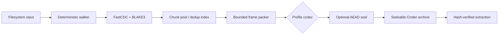

<p align="center">
  
</p>

<h1 align="center">Cinder</h1>

<p align="center">
  <b>Lossless, deduplicating archives for real workloads.</b><br/>
  Smaller snapshots. Seekable files. Zero guesswork.
</p>

<p align="center">
  <a href="https://github.com/Karmanya03/Cinder/actions"></a>
  
  
  
  <a href="LICENSE"></a>
</p>

<p align="center">
  
  
  
</p>

---

## Contents

- [Why Cinder](#why-cinder)
- [Features](#features)
- [Compression profiles](#compression-profiles)
- [Installation](#installation)
- [One-line installers](#one-line-installers)
- [CLI](#cli)
- [GUI](#gui)
- [Supported platforms](#supported-platforms)
- [Architecture](#architecture)
- [Security model](#security-model)
- [Performance engineering](#performance-engineering)
- [Development](#development)
- [Release](#release)
- [Roadmap](#roadmap)
- [License](#license)

## Why Cinder?

Most archivers make you choose between a tiny archive, fast extraction, or
random access. Cinder is designed for the uncomfortable workloads where all
three matter: VM snapshots, rotated logs, build caches, media-heavy folders,
and directories with thousands of near-duplicate files.

Cinder is deliberately lossless. A successful extraction reproduces the
original file bytes exactly, while archive chunks are verified with BLAKE3.
There is no universal compressor that wins on every corpus, so Cinder exposes
measurable profiles instead of promising an impossible "best compression"
number. Use `max` when archive size matters most, `fast` when turnaround wins,
and benchmark your own corpus before making a production choice.

## Features

| Capability | What it gives you |
| --- | --- |
| Content-defined chunking | Near-identical files share chunks even when bytes shift around. |
| Cross-file deduplication | Repeated data is stored once per archive. |
| Solid small-file batching | Thousands of small files get shared compression context. |
| Seekable frame layout | Extract one member without decoding the complete archive. |
| Adaptive stored-frame gate | Already-compressed or incompressible data is not needlessly recompressed. |
| Background GUI jobs | Compression, extraction, opening, and verification keep the UI responsive. |
| Optional encryption | Argon2id-derived keys and XChaCha20-Poly1305 authenticated payloads. |
| Safety limits | Path confinement and streaming decompression budgets reject hostile archives. |
| Interoperability | 7z, RAR 1.3–7, ZIP, TAR, TAR.GZ, TAR.ZST, TAR.XZ, Gzip, XZ, and Zstandard streams. |
| Native Rust binaries | CLI and desktop GUI with no runtime or scripting dependency. |
| Adaptive corpus benchmarking | Samples codecs first, then emits verified JSON/Markdown reports. |
| Delta snapshots | Changed-file archives with base-digest validation and safe apply. |
| Persistent chunk index | Versioned, locked metadata index for snapshot families. |
| Signed manifests | Detached Ed25519 signatures cover archive and deterministic manifest digests. |

## Compression profiles

| Profile | Codec | Best for | Trade-off |
| --- | --- | --- | --- |
| `fast` | Zstandard | Active workspaces and repeated backups | Fastest turnaround; less compact |
| `balanced` | Zstandard 15 | General-purpose archives | Strong default for mixed data |
| `max` | XZ/LZMA2 9 | Cold storage and distribution | Smallest result on many text-heavy corpora; slower |

The native format also stores raw frames when compression would expand the
data. `--threads N` makes performance experiments reproducible and lets
low-memory deployments cap concurrency.

## Installation

### Download a release

The GitHub release workflow publishes platform-specific CLI and GUI archives.
Use the latest release page once a tag has been published:

```text
https://github.com/Karmanya03/Cinder/releases/latest
```

### Build from source

```bash
git clone https://github.com/Karmanya03/Cinder.git
cd Cinder
cargo build --release --workspace
```

### One-line installers

The installers download a tagged release over TLS, verify `SHA256SUMS`, and
install without administrator privileges by default. Pin a release with
`CINDER_VERSION` for production automation.

```bash
curl --proto '=https' --tlsv1.3 -fsSL https://raw.githubusercontent.com/Karmanya03/Cinder/main/scripts/install.sh | sh
```

```powershell
irm https://raw.githubusercontent.com/Karmanya03/Cinder/main/scripts/install.ps1 | iex
```

Set `CINDER_COMPONENT=gui` or pass `-Component gui` to install the desktop
binary. For reproducible automation, set `CINDER_VERSION=vX.Y.Z` and a
controlled `CINDER_INSTALL_DIR`.

### Requirements

- Rust stable and Cargo.
- Linux GUI builds need the usual windowing/OpenGL development libraries.
- Android/iOS packaging requires their native SDKs and is kept separate from
  the desktop file-browser target; see [Supported platforms](#supported-platforms).

## CLI

```bash
# Native archive
cinder compress ./snapshot --output snapshot.cnd --profile max --threads 8

# Encrypted native archive
set CINDER_PASSPHRASE=correct-horse-battery-staple
cinder compress ./private --output private.cnd --encrypt

# Extract and verify
cinder verify snapshot.cnd
cinder extract snapshot.cnd --output restored

# Single-member random access
cinder get snapshot.cnd path/to/database.bin --output database.bin

# Foreign formats
cinder compress ./logs --output logs.7z --format seven-z --threads 8
cinder compress ./logs --output logs.rar --format rar
cinder compress ./logs --output logs-legacy.rar --format rar --rar-version rar40
cinder compress ./logs --output logs-split.rar --format rar --rar-version rar50 --volume-size 100MB
cinder compress ./logs --output logs.zip --format zip
cinder compress ./logs --output logs.tar.xz --format tar-xz
cinder x logs.zip --output logs-restored
cinder list any-supported-archive
cinder bench ./reference-workload

# Adaptive corpus report
cinder bench ./reference-workload --output corpus-report.json --sample-bytes 8388608

# Persistent cross-archive chunk metadata
cinder index ./.cinder/chunks.cidx snapshot.cnd

# Delta snapshot lifecycle
cinder delta compare snapshot.cnd ./workspace
cinder delta create snapshot.cnd ./workspace --output workspace.delta.cnd
cinder delta apply snapshot.cnd workspace.delta.cnd --output restored

# Detached Ed25519 manifest signing
cinder keygen ~/.config/cinder/release.key
cinder sign snapshot.cnd --key ~/.config/cinder/release.key
cinder verify-signature snapshot.cnd
```

Every real command starts with the Cinder banner. `cinder --help` stays clean
for shell completion and documentation tooling.

## GUI

```bash
cargo run --release -p cinder-gui
```

The GUI uses the Cinder logo as its window icon and in-app mark. It includes:

- drag-and-drop archive creation and opening, with format detection and grouped
  extraction for multiple archives;
- multi-file and multi-folder archive creation from the browser, drag/drop, or
  Windows Explorer selection;
- per-user Windows Explorer menus for open, create, extract, and archive test;
- searchable, sortable member tables;
- right-click actions on files, archives, and archive members;
- multi-select extraction with one output folder per archive by default;
- safe defaults: extraction does not overwrite and archive creation asks before
  replacing an existing output;
- a persistent Tips panel with workflow guidance;
- progress reporting without blocking the interface;
- native archive verification and encrypted archive unlock;
- keyboard shortcuts: Ctrl/Cmd+N, O, E, T, A, and Escape.

On Windows, build the GUI and add the Cinder submenu to the current user's
Explorer menus:

```powershell
cargo build --release -p cinder-gui
powershell -ExecutionPolicy Bypass -File .\scripts\install-shell-menu.ps1 `
  -GuiPath .\target\release\cinder-gui.exe
```

The installer does not require administrator access. It adds grouped commands
for selected files and folders. Remove the menus with:

```powershell
powershell -ExecutionPolicy Bypass -File .\scripts\uninstall-shell-menu.ps1
```

To launch the GUI directly:

```powershell
cargo run --release -p cinder-gui
```

## Supported platforms

| Target | CLI | Desktop GUI | Release status |
| --- |:---:|:---:| --- |
| Windows x86_64 | Yes | Yes | CI/release target |
| Linux x86_64 GNU | Yes | Yes | CI/release target |
| Linux x86_64 musl | Yes | CLI-first | Static CLI target |
| macOS Intel | Yes | Yes | CI/release target |
| macOS Apple Silicon | Yes | Yes | CI/release target |
| Android | Core + SAF/JNI shell | Android SDK/NDK + keystore | Manual/mobile workflow |
| iOS | Core + SwiftUI document shell | Xcode + signing profile | Manual/macOS workflow |

The archive engine is platform-independent Rust. Android and iOS need a
mobile-native shell for document providers, permissions, background jobs, and
share sheets; the desktop GUI's unrestricted filesystem browser cannot simply
be relabeled as a phone app. The mobile work is tracked explicitly in the
roadmap and architecture docs rather than hidden behind a misleading build
badge.

## Architecture

The detailed design, data flow, archive layout, safety boundaries, and mobile
split are in [`ARCHITECTURE.md`](ARCHITECTURE.md). The high-level flow is:



## Security model

- Archive paths are confined beneath the extraction root.
- Decompression is bounded while streaming, not after an unbounded allocation.
- BLAKE3 validates chunk identity during reads.
- Encrypted frames and manifests use XChaCha20-Poly1305.
- Passphrases derive keys with Argon2id and are not written into manifests.
- Malformed archives return errors instead of panicking on data-dependent paths.
- Foreign formats receive the same path-confinement and decompression-budget
  protections through `cinder-formats`. RAR creation supports generations 1.3
  through 7.0; RAR 5/7 can be written as split volumes. Listing, testing, and
  extraction accept modern `.partNN.rar`, legacy `.rar`/`.r00`, and numbered
  `.001` sets when the RAR signature is present. 7z and RAR support passwords;
  older RAR generations use their legacy encryption behavior.

Do not treat encryption as a substitute for key management. Keep passphrases
out of shell history and use `CINDER_PASSPHRASE` or an external secret store.

## Performance engineering

Cinder optimizes the full pipeline, not only the entropy coder:

1. deterministic walking makes runs reproducible;
2. FastCDC preserves reuse across shifted snapshots;
3. BLAKE3 fingerprints deduplicate before compression work is scheduled;
4. bounded channels cap in-flight memory;
5. mmap avoids copying large source files into intermediate buffers;
6. worker count is tunable with `--threads`;
7. frame-level caching makes repeated random access cheap;
8. stored-frame detection avoids wasting CPU on media and compressed data;
9. adaptive sampling recommends a profile from the real corpus;
10. persistent indexes and delta descriptors avoid reprocessing unchanged snapshots.

Measure with your own data:

```bash
cargo bench -p cinder-core
cinder bench ./reference-workload --output corpus-report.json
```

Benchmark policy and reproducibility notes live in [`docs/BENCHMARKS.md`](docs/BENCHMARKS.md).
Claims about beating WinRAR or 7-Zip should only be added after running the
same corpus, settings, filesystem, CPU, and extraction checks against each
tool. "Perfect quality" here means exact lossless restoration—not a claim
that one algorithm produces the smallest possible file for every input.

## Development

```bash
cargo fmt --all -- --check
cargo check --workspace
cargo test --workspace
cargo clippy --workspace --all-targets -- -W clippy::pedantic
```

Workspace layout:

```text
cinder-core/      chunking, codecs, archive format, crypto, extraction
cinder-formats/   7z/RAR/ZIP/TAR/Gzip/XZ/Zstd adapters and safety guards
cinder-cli/       clap CLI, progress UI, release binary
cinder-gui/       egui desktop interface
assets/           Cinder logo and release branding
docs/             benchmarks and architecture notes
fuzz/             cargo-fuzz archive/parser targets
```

## Release

Use `scripts/release.ps1 -Version vX.Y.Z` from a clean worktree. The script
creates an annotated tag; GitHub Actions builds native desktop artifacts, the
Linux musl CLI, checksums, reproducible build metadata, and build provenance
attestations. The mobile workflow is manually dispatched because Android
keystores, Apple provisioning, and signing identities must remain outside the
repository.

Before publishing a release:

- run the full workspace tests;
- run the three reference benchmark workloads;
- verify archive round-trips and encrypted archives;
- inspect generated checksums and provenance attestations;
- sign mobile artifacts only in the protected mobile workflow.

## Roadmap

- [x] Lossless native archive with deduplication and seekable extraction
- [x] ZIP/TAR/Gzip/XZ/Zstd interoperability
- [x] Responsive logo-branded GUI with contextual tips
- [x] CI/release scaffolding for Windows, Linux musl, and macOS
- [x] Adaptive multi-codec benchmarking mode with corpus reports
- [x] Native mobile document-provider shell for Android
- [x] Native iOS document-picker/share-sheet shell and signed IPA pipeline
- [x] Delta snapshots and persistent cross-archive chunk indexes
- [x] Signed manifests and reproducible release attestations

## License

Cinder is released under the [MIT License](LICENSE).
